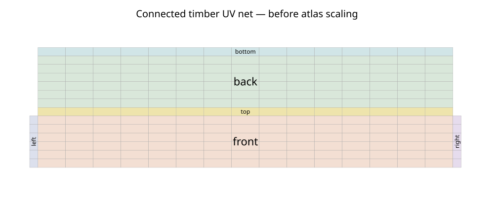

# Old Shed Builder

A modular **Blender 4.3+** Python add-on for timber sheds with separately modeled
framing, solid deformed boards, framed openings, geometric light leakage, and
camera visibility profiles. Developed and tested with **Blender 4.3.2**.
No third-party Python dependencies are required. Current add-on version: **1.1.0**.

## Install and generate

1. Download [old_shed_builder.zip](downloads/old_shed_builder.zip) from GitHub
   using **Download raw file** on the ZIP page, or build it locally with the command below.
2. In Blender: **Edit → Preferences → Add-ons → menu → Install from Disk**.
   Select the ZIP and enable **Old Shed Builder**.
3. In the 3D View, press **N**, open **Old Shed**, and use **Generate / Rebuild**
   or **Small Dilapidated Shed**.
4. Edit the collapsible sections, then press **Update Parameters**. Parameter
   edits are saved in the `.blend`; construction only changes on an explicit update.

**Upgrading from 1.0:** install the new ZIP and restart Blender (or disable and
re-enable the add-on). Open your saved shed and run **Generate / Rebuild** once
to create the new UV atlases. Preserved edited objects keep their previous UVs;
disable Preserve User Edits only if you want those pieces regenerated too.

The [source bundle](downloads/old_shed_builder_source.zip) contains the add-on,
tests, scripts, and documentation. Install the add-on ZIP, not the source bundle.

To build both ZIPs from source (outputs go to `artifacts/`):

```sh
python scripts/package.py
```

Generate the sample scenes using `scripts/create_sample.py` (command below);
large generated scenes and renders are not stored in Git. Then open
`artifacts/small_dilapidated.blend` for the exterior example and
`artifacts/cutaway.blend` for an interior/framing view. Enable the add-on to edit
their parameters; the meshes render without it. Sample PNGs are `exterior.png`
and `cutaway.png`. Sample scenes use Cycles CPU; denoising is disabled because
the tested Blender build has no OpenImageDenoise support.

## Construction and coordinates

Dimensions are meters. X is width; Y runs from front (negative Y) to rear;
Z points up. Width/length measure outside framing faces. The finished floor is
foundation height + joist depth + floorboard thickness. Wall height is measured
from that floor to the top of the double top plate. The ridge runs along Y.
Opening positions measure their center from the wall's negative X/Y endpoint;
opening widths/heights are **rough framing dimensions**, before jambs.

The model includes six foundation piers, rim/interior joists, floorboards,
bottom/double top plates, corner backing, king/jack studs, supported headers,
sills, cripples, gable studs, birdsmouth rafters, ridge, optional collar ties,
optional roof sheathing, and a separate board roof skin. Horizontal siding is
cut around openings, the ridge, and rafter penetrations. Door header height follows **Stud width**, the same thickness used by floor
joists (45 mm by default); **Window header height** remains independent. The door's
**Door hinge side** selects left/right as viewed from outside the selected wall.
A positive **Door angle** opens outward for either hand, with hinges, handle,
and diagonal brace moving to the corresponding side. A plank door rotates
around a hinge pivot; two independently positioned windows have optional
solid glass, broken panes, and shutters.

The root Empty moves/rotates the entire shed. The `Active shed` selector and
`Load Selected Shed` load the settings for another generator. `New Shed` creates
an independent instance. Objects and collections have stable semantic keys
and unique ownership IDs; unrelated scene objects are retained.

## Rebuilds and manual edits

- **All components:** use after dimension, opening, plank, deformation, or seed
  changes. Replacement geometry is constructed before existing components are removed.
- **Framing only:** replace structural members; window-header-height and collar-tie
  changes are supported. Changes affecting siding, floorboards, or roof skins
  require All components.
- **Wall cladding only:** update global/per-wall light leakage without replacing
  the frame or fixtures. Gap randomizer, Gap random weight, and Crooked also support
  this scope. Shared plank/deformation dimensions require All components.
- **Materials only:** update aging, roughness, grain, dirt, staining, and color
  variation while retaining meshes.

Incompatible partial updates report the parameters requiring a full rebuild.

With **Preserve User Edits** enabled, changed mesh geometry, transforms, material
graphs/assignments, UVs, shape keys, animation, constraints, and supported modifier properties are retained.
An edited door/window assembly preserves the entire fixture group, including
its hinge parent. Set an object's custom property `shed_preserve = True` to mark
it explicitly. Edits to a shared material can preserve every object using it.
Preserved pieces keep their previous geometry even if the new dimensions no
longer fit; retained counts are reported. Disable preservation to regenerate
them. Deleting a generated piece does not record a tombstone: it returns on rebuild.

**Bake to Editable Meshes** creates an independent, evaluated mesh/material
snapshot. Its collection starts hidden to prevent overlapping renders. Hide the
procedural collection and enable the baked collection to use it. The source
remains available for further editing.

## Deformation and weathering

Every plank is a subdivided solid with continuous bow, twist, cupping, edge
wear, end splits, shortened broken ends, and optional end detachment. Top and
bottom skins retain physical thickness. Supported sections constrain deformation;
siding uses available framing locations and floorboards follow joist spacing.
Bow, cup, twist, and damage have dimension-relative limits. Detached ends bend
outward from their remaining attachment region.

**Broken** is the probability of damage, with start-only, end-only, and both-end
breaks selected deterministically. **Max broken length (%)** caps the combined
length removed from both ends, as a percentage of the original board length
(0–95%). This cap is further scaled by Variation. End splitting is a separate
control. Remaining geometry stays solid even at the maximum damage setting.

In **Cladding**, **Gap randomizer** blends regular spacing (0) into random gaps
from zero to the configured maximum (1). **Gap random weight** applies
`random^(1/weight)`: below 1 favors no gap, 1 is uniform, above 1 favors maximum
gaps. It uses the existing independent leakage seed and works with per-wall
leakage overrides. At zero leakage it randomizes the base Plank gap; it does
not create gaps when the maximum gap is zero.

**Crooked** tilts horizontal siding in the wall plane, using actual neighboring
board silhouettes, opening boundaries, and the roof/floor as limits. At 1 it
uses the available safe rotation in a seeded direction, with a small vertical
adjustment to balance unequal upper/lower gaps. Boards are fitted sequentially;
no free space means no tilt. A fitting allowance of up to 5 mm per end prevents
rotation from pushing the ends into corners/openings. Crookedness operates
independently of the wood Variation slider; preserved edited boards act as fixed
neighbors. It does not rotate studs, rafters, door leaves, or floorboards.

The wood seed controls deformation and board color. `Variation` scales these
wood effects. `Randomize Weathering` advances both deterministic seeds and
rebuilds. `Reset Weathering` generates sound, minimally aged timber with leakage
disabled; the base construction gap remains. The small dilapidated preset restores
a weathered configuration.

Opaque procedural materials use longitudinal grain, distinct per-board noise
offsets, gray/brown aging, roughness, low-level fiber bump, gravity-aligned water
stains, and dirt near the ground. Major damage is mesh geometry.

## Connected UVs and material atlases



Each rectangular timber uses the supplied net: **front → top → back → bottom**
in one connected strip, with **left/right end caps attached to the front**.
Long axes stay horizontal. Subdivided planks retain continuous UVs through their
subdivisions; deformation moves the surface beneath its rest-shape UVs. Clipped
gable profiles follow the same folding pattern. Notched rafters and irregular
cuts retain their broad-face net, with small additional islands for cut faces
that cannot fit that fold without overlap.

`UVMap` is the active render/painting map. Nets are scaled uniformly and packed
without overlap in 0–1, separately for these material groups:

- Cladding: all wall siding.
- Framing: studs, plates, headers, joists, rafters, ridge, and ties.
- RoofSheathing: the roof underlayer.
- DoorsWindows: wooden leaves, jambs, shutters, and braces.
- Floorboards and RoofCovering: each gets a separate additional atlas.
- Glass: each pane gets its own material/atlas; shards of a broken pane share it.
- Metal and Concrete: their own atlases.

Each group shares a material and texel scale. New nets have a 0.001 UV-unit
border margin (about 4 pixels at 4K). UVs of preserved edited objects remain
untouched and reserve space in the atlas; fitting new nets around them can
require a different scale. Material-only updates and visibility changes do not
repack UVs. Baking retains both UV layers.

`WoodGrain` is a separate local coordinate layer used by the procedural grain
shader, so repacking an atlas does not stretch the grain. It is not the painting
atlas and is not constrained to 0–1. Use `UVMap` for image textures, painting,
and baking; every material includes a labeled UVMap node for that purpose.

## Cinematic visibility and real light leakage

The **Cinematic Visibility** panel provides separate **viewport** and **render**
columns for each wall, all roof geometry, roof covering/sheathing, roof framing,
floor/foundation, cladding, structural framing, and fixtures. Collection flags
compose: disabling a wall hides all its layers. Disabling roof covering also
hides the sheathing. Render-hidden collections are excluded from shadow rays,
so they cannot act as invisible light blockers. These toggles do not rebuild.

Save a named visibility profile for the active camera, then restore it manually
or enable **Follow active camera**. Automatic profiles apply both viewport and
render settings when the scene's active camera changes (including camera-marker
animation). This uses global collection visibility; it is not separate simultaneous
visibility per camera or per view layer. Saving another profile for the same
camera replaces that camera binding while keeping the earlier named profile.

Light leakage uses actual spaces between boards, absent pieces, and detached
ends. The global amount scales added gaps, gap variation, larger-gap probability,
missing/loose frequency, and end separation. Each wall can override those values.
The leakage seed is independent of the wood seed. `Dramatic` multiplies leakage
by 1.8 and relaxes the gap limit. At amount zero, only the base plank gap and
separately enabled wood deformation remain. For a fully sealed diagnostic wall,
set the base gap and wood variation to zero as well.

Use Cycles and an external sun/sky for physical illumination. The add-on does
not inject lights into an existing scene; the example scripts create their own
clearly named camera/light rig.

## Staged implementation and tests

See [architecture](docs/ARCHITECTURE.md), [stage guide](docs/STAGES.md), and
[validation notes](docs/VALIDATION.md).

```sh
# Each stage saves artifacts/stage_XX.blend
blender --background --factory-startup --python-exit-code 1 --python tests/run_stage.py -- 1
# Stages 2–9 use the same command with the corresponding number.
blender --background --factory-startup --threads 4 --python-exit-code 1 --python tests/test_production.py
blender --background --factory-startup --threads 4 --python-exit-code 1 --python tests/test_builder_v11.py
blender --background --factory-startup --threads 4 --python-exit-code 1 --python tests/test_light_transport.py
python scripts/package.py
# Isolate add-on installation/preferences during the installation test:
BLENDER_USER_SCRIPTS=/tmp/shed-install/scripts BLENDER_USER_CONFIG=/tmp/shed-install/config \
  BLENDER_USER_EXTENSIONS=/tmp/shed-install/extensions \
  blender --background --factory-startup --python-exit-code 1 --python tests/test_install_and_persistence.py
# Recreate the photographic examples:
blender --background --factory-startup --threads 4 --python-exit-code 1 \
  --python scripts/create_sample.py -- render
# Version 1.1 example with weighted gaps, crookedness, and varied end damage:
blender --background --factory-startup --threads 4 --python-exit-code 1 \
  --python scripts/create_sample.py -- v11 render
```

Tests use real Blender geometry and Cycles, not mocked `bpy`. The production
suite writes `stage_10.blend`; the installation test reopens it in a fresh
Blender process. Run scripts from the repository root.

The generator is intended for cinematic scene construction. Deformation limits
reduce intersections, but there is no global collision solver or structural
load calculation. Extreme manually preserved geometry and arbitrary combinations
of heavy damage need shot-specific inspection. The panels/operators are tested
through Blender's API; no automated GUI clicking or cross-version certification
is claimed.
